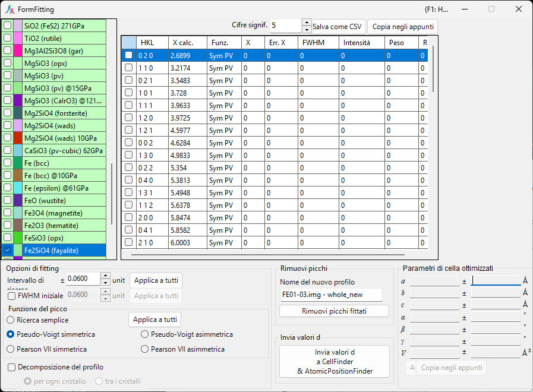
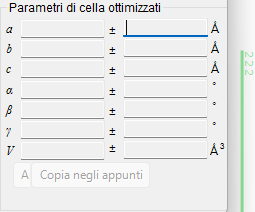
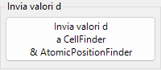
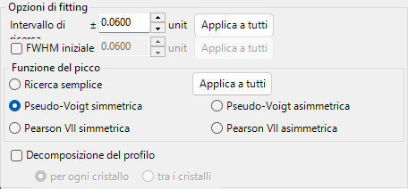
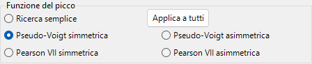
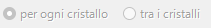
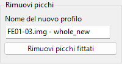
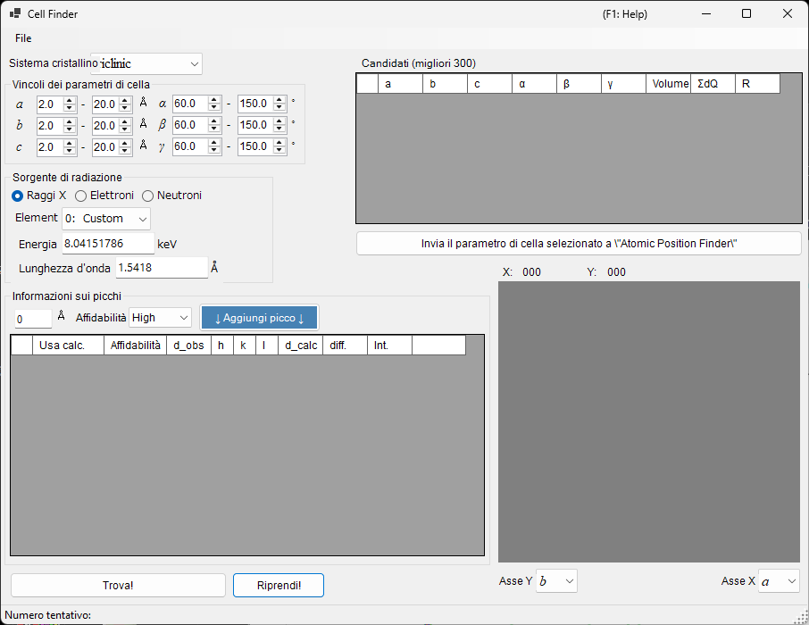

<!-- 260601Cl: migrated from legacy docx + yseto.net web manual -->
# Fitting dei picchi di diffrazione

Lo strumento `Adattamento picchi di diffrazione (F)` esegue il fitting dei picchi di un profilo di diffrazione con una funzione appropriata, ricava la distanza interplanare (valore d) dalla posizione 2θ di ciascun picco e raffina i parametri reticolari con il metodo dei minimi quadrati. Viene avviato dalla barra degli strumenti della finestra principale.

## Flusso di lavoro di base

1. Seleziona il cristallo di interesse nell'elenco dei cristalli (in modalità multi-profilo, seleziona anche il profilo su cui vuoi lavorare).
2. Nella finestra principale, trascina con il mouse le linee di diffrazione in modo che si sovrappongano il più possibile ai picchi misurati.
3. Scegli gli indici delle linee di diffrazione di cui vuoi eseguire il fitting dall'elenco dei picchi di diffrazione (una casella di elenco con caselle di controllo).
4. Una volta scelti indici indipendenti in numero sufficiente affinché il calcolo dei minimi quadrati sia risolvibile, i parametri reticolari più probabili compaiono, con i relativi errori, nel pannello `Parametri di cella ottimizzati` in basso a destra.
5. Premi `Applica al cristallo` per riportare i parametri reticolari raffinati sul cristallo nel programma principale.

!!! note "Verifica e selezione di un cristallo"
    L'elenco dei cristalli rispecchia quello della finestra principale. Perché il fitting abbia effetto, il cristallo di interesse deve essere sia spuntato sia selezionato.

## Elenco dei cristalli

L'elenco dei cristalli in alto a sinistra contiene gli stessi cristalli della finestra principale. Il cristallo che spunti e selezioni qui diventa l'obiettivo del fitting. Vedi [Parametri del cristallo](3-crystal-parameter.md) per i dettagli.

## Elenco dei picchi di diffrazione

Qui vengono elencate le linee di diffrazione del cristallo selezionato. Attivando la casella di controllo di una riga, quella linea di diffrazione diventa un obiettivo del fitting. L'elenco contiene colonne come le seguenti.

| Colonna | Contenuto |
| --- | --- |
| `Selez.` | Se includere o meno la linea nel fitting |
| `Colore picco` | Colore di visualizzazione |
| `Cristallo` | Nome del cristallo |
| `HKL` | Indici di riflessione |
| `X calc.` | Posizione calcolata della linea di diffrazione |
| `Funz.` | Funzione di picco usata |
| `X` | Posizione del picco ottenuta dal fitting |
| `Err. X` | Errore della posizione del picco |
| `FWHM` | Larghezza a metà altezza |
| `Intensità` | Intensità del picco |
| `Peso` | Peso nel fitting ai minimi quadrati |
| `R` | Indice di residuo del fitting |

I pulsanti sotto l'elenco esportano i risultati.

- `Copia negli appunti`: Copia la tabella negli appunti. Può essere incollata direttamente in Excel e applicazioni simili.
- `Salva come CSV`: Salva la tabella come file `.csv`. `Cifre signif.` imposta il numero di cifre significative mostrate nella tabella.
- `Cancella picchi`: Elimina tutti i picchi aggiunti manualmente al Flexible Crystal.

## Fitting option

Qui si effettuano le impostazioni dettagliate usate durante il fitting dei profili dei picchi.

### Search Range / Initial FWHM

- `Intervallo di ricerca`: Imposta l'intervallo entro cui viene eseguito il fitting. Cioè, la regione entro ±`Intervallo di ricerca` dalla posizione calcolata della linea di diffrazione viene assunta come obiettivo del fitting per quel picco.
- `FWHM iniziale`: Specifica la larghezza a metà altezza iniziale della funzione di profilo. Viene usata come valore di partenza per la convergenza ai minimi quadrati.

Premendo `Applica a tutti` si applicano le impostazioni correnti a tutte le linee di diffrazione in una sola volta.

### Peak function

Seleziona la funzione di picco usata per il fitting.

| Funzione di picco | Contenuto |
| --- | --- |
| `Ricerca semplice` | Non esegue alcun fitting di funzione; riconosce come posizione del picco il punto di intensità più elevata entro ±Search Range dalla posizione calcolata della linea di diffrazione. |
| `Pseudo-Voigt simmetrica` | Esegue il fitting con una funzione pseudo-Voigt simmetrica destra-sinistra. |
| `Pearson VII simmetrica` | Esegue il fitting con una funzione Pearson VII simmetrica destra-sinistra. |
| `Pseudo-Voigt asimmetrica` | Esegue il fitting con una funzione pseudo-Voigt asimmetrica (split) destra-sinistra. |
| `Pearson VII asimmetrica` | Esegue il fitting con una funzione Pearson VII asimmetrica (split) destra-sinistra. |

!!! tip "Funzione consigliata"
    Se non c'è un motivo particolare, si consiglia `Pseudo-Voigt simmetrica` per la sua stabilità superiore.

La funzione pseudo-Voigt è una combinazione lineare di una gaussiana \(G(x)\) e una lorentziana \(L(x)\) con parametro di mescolamento \(\eta\), data da:

$$
\mathrm{pV}(x) = \eta\, L(x) + (1-\eta)\, G(x), \qquad 0 \le \eta \le 1
$$

dove \(\eta\) è la frazione della componente lorentziana. La forma split rappresenta un profilo asimmetrico assumendo parametri come la FWHM in modo indipendente a sinistra e a destra della posizione del picco.

### Pattern Decomposition

Quando le regioni `Intervallo di ricerca` di due o più linee di diffrazione selezionate si sovrappongono, questa opzione permette di scegliere se eseguire la decomposizione del profilo (fitting simultaneo dei picchi sovrapposti).

- `per ogni cristallo`: Esegue la decomposizione del profilo in modo indipendente per ciascun cristallo.
- `tra i cristalli`: Esegue la decomposizione del profilo attraverso tutti i cristalli.

## Optimized cell constants

Una volta scelti indici indipendenti in numero sufficiente affinché il calcolo dei minimi quadrati diventi risolvibile, questo pannello visualizza i parametri reticolari più probabili \(a, b, c, \alpha, \beta, \gamma\) e il volume \(V\), ciascuno con il proprio errore (`±`).

!!! note "Informazioni sulla visualizzazione NA"
    Quando il numero di riflessioni fittate è uguale al numero di parametri reticolari indipendenti, i residui non consentono di ricavare gli errori standard, quindi nei campi dell'errore viene visualizzato `NA`. Quando le riflessioni indipendenti sono troppo poche per risolvere i parametri reticolari, il programma mantiene la forma originale della cella e ne modifica solo la scala complessiva, e gli errori vengono mostrati come `NA`. Scegliere un numero sufficiente di riflessioni indipendenti consente di calcolare gli errori.

- `Applica al cristallo`: Riporta i parametri reticolari raffinati sul cristallo selezionato nel programma principale.
- `Copia negli appunti`: Copia i parametri reticolari ottimizzati negli appunti.

## Remove fitted peaks

Sottrae i picchi fittati dal profilo e restituisce il profilo residuo come nuovo profilo. Inserisci il nome di destinazione in `Nome del nuovo profilo` e premi `Rimuovi picchi fittati` per eseguire la sottrazione. È utile per verificare il fondo o la separazione di picchi sovrapposti.

## Strumenti correlati (Send d-values)

Premendo `Invia valori d a CellFinder && AtomicPositionFinder` si inviano i valori d ottenuti dal fitting delle riflessioni spuntate a `Cell Finder`. Apri `Cell Finder` dalla barra degli strumenti. <!-- 261124Cl changed (author decision): the Atomic Position Finder, not available in the current version, is no longer described -->

### Cell Finder

`Cell Finder` cerca i candidati per i parametri reticolari che spiegano un insieme di posizioni di picco misurate (un elenco di valori d). Viene usato per indicizzare campioni sconosciuti.

!!! tip "Identificazione di un campione sconosciuto"
    Dopo aver determinato i parametri reticolari con `Cell Finder`, registra quel cristallo nell'elenco dei cristalli e potrai raffinare ulteriormente i parametri reticolari con il fitting ai minimi quadrati di questo strumento.
