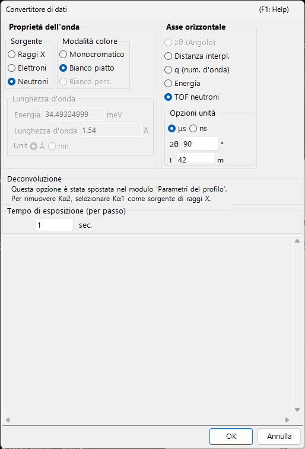

<!-- 260601Cl: migrated from legacy docx + yseto.net web manual -->
# Formati di file

I file che PDIndexer legge e scrive si dividono in tre gruppi: **dati di profilo**, **liste di cristalli / strutture cristalline** e **output grafico**. Tutte queste operazioni di I/O si eseguono dal menu `File` della [finestra principale](../1-main-window.md).

Questa pagina riassume in forma tabellare le estensioni supportate, la direzione di I/O e le note.

---

## Dati di profilo

### Lettura (Read profile(s))

`File` ▸ `Leggi profilo/i` consente di caricare più file contemporaneamente. Oltre al formato nativo di PDIndexer `pdi` / `pdi2`, supporta una varietà di formati testuali e binari angolo-intensità (o energia-intensità), come il `csv` di WinPIP, il `chi` di Fit2D e il `ras` di Rigaku. Anche i formati non elencati qui sotto possono di solito essere letti: qualsiasi file di testo angolo-intensità semplice ricade su un parser generico.

| Estensione | Origine / formato | Note |
| --- | --- | --- |
| `pdi` / `pdi2` | Formato nativo di PDIndexer | Conserva il profilo insieme alle informazioni associate (sorgente d'onda, lunghezza d'onda, tempo di esposizione, ecc.). `pdi2` è la versione attuale. La finestra di dialogo Data Converter non viene mostrata durante la lettura di questi. |
| `csv` | Output di WinPIP (separato da virgole: `angle,intensity`) | Importato tramite la finestra di dialogo Data Converter, dove si specifica il significato dell'asse orizzontale, la sorgente d'onda e la lunghezza d'onda. |
| `tsv` | Separato da tabulazioni (`angle` `[TAB]` `intensity`) | Importato come testo generico. |
| `chi` | Output di Fit2D | Le righe di intestazione iniziali vengono saltate; le colonne 2 e 4 dei dati a quattro colonne sono prese come angolo e intensità. |
| `ras` | Formato Rigaku | Formato testuale che contiene anche informazioni sullo strumento. |
| `nxs` | NeXus / HDF5 (SSD, rivelatori multipli) | Può contenere diversi canali (istogrammi); ciascuno viene calibrato in energia e importato separatamente. |
| `npd` | Profilo EDX (SSD) | Legge `2Theta` e `Live time` dall'intestazione come angolo di take-off e tempo di esposizione. I punti dati usano la colonna dell'energia presente nel file (il numero di canale non viene convertito con i coefficienti `EGC0/1/2`). |
| `xbm` | Formato binario EDX (ad es. SP-8 BL04B2) | I metadati come nome del campione, condizioni di misura e coefficienti di calibrazione EGC vengono importati come commento. |
| `rpt` | Formato Genie (SSD) | Legge l'angolo di uscita, il tempo di esposizione e l'EGC dall'intestazione. |
| `xy` | Testo a due colonne calibrato con pyFAI | Legge la lunghezza d'onda dall'intestazione e importa angolo e intensità. |
| `gsa` | Dati GSAS (blocco `BANK`) | Importa le tre colonne: angolo, intensità, errore. |
| Altro | Testo generico angolo-intensità | Il delimitatore virgola / spazio / tabulazione viene rilevato automaticamente (tramite la finestra di dialogo Data Converter). |

!!! note "Caricamento di più file contemporaneamente"
    Quando selezioni e leggi più file, dopo aver confermato le impostazioni del `Convertitore di dati` per il primo file un messaggio chiede se riutilizzare le stesse impostazioni per i file rimanenti. Scegliendo **Yes** i restanti vengono elaborati senza mostrare la finestra di dialogo, il che velocizza il caricamento.

### Finestra di dialogo Data Converter

Quando leggi un file diverso da `pdi` / `pdi2` (`csv`, `chi`, `ras`, `nxs`, `npd`, `xbm`, `rpt`, `xy`, `gsa` e testo generico), si apre la finestra di dialogo `Convertitore di dati`. È qui che mappi le colonne numeriche importate alle grandezze fisiche corrette usate internamente da PDIndexer.

La finestra di dialogo offre le seguenti impostazioni.

| Impostazione | Descrizione |
| --- | --- |
| `Asse orizzontale` | La grandezza fisica (2θ, energia, distanza interplanare (valore d), numero d'onda, TOF, ecc.) e l'unità rappresentate dalla prima colonna importata. |
| `Proprietà dell'onda` | Raggi X / neutroni / elettroni, e la linea caratteristica dei raggi X (Kα, ecc.) o la lunghezza d'onda. Questo determina la conversione in distanza interplanare (valore d) e 2θ. |
| `Tempo di esposizione (per passo)` | Il tempo di esposizione per passo in secondi. Usato per la visualizzazione in CPS e la normalizzazione dell'intensità. |
| `Per dati SSD` | Per dati SSD (EDX) come `rpt` / `npd` / `xbm` / `nxs`, imposta i coefficienti \(a_0, a_1, a_2\) che convertono il numero di canale \(n\) in energia \(E\). Quando ci sono più rivelatori, puoi abilitare/disabilitare ciascuno e impostarne i coefficienti individualmente. `npd` usa la colonna dell'energia presente nel file, quindi questi coefficienti non vi vengono applicati. |
| `Taglio a bassa energia` | Se selezionato, i punti dati al di sotto dell'energia specificata vengono esclusi durante l'importazione. |

Per i dati SSD, il numero di canale \(n\) viene convertito in energia \(E\) (in eV) mediante una calibrazione quadratica:

$$
E = a_0 + a_1\,n + a_2\,n^2
$$

Quando si legge testo generico (un formato "altro"), la finestra di dialogo mostra il contenuto effettivo del file in una casella di testo, così puoi impostare l'asse orizzontale, la sorgente d'onda e così via mentre ispezioni i dati. Il delimitatore (virgola / spazio / tabulazione) e il numero di righe di intestazione iniziali da saltare vengono rilevati automaticamente.

!!! tip "Monitoraggio degli appunti / di una cartella"
    Abilitando `Opzioni` ▸ `Monitora appunti` PDIndexer importa automaticamente i profili copiati da altre app come IPAnalyzer. Abilitando `Opzioni` ▸ `Monitora file` legge automaticamente i file `pdi` appena creati in una cartella scelta.

### Salvataggio ed esportazione

`File` ▸ `Salva profilo/i` salva tutti i profili caricati nel formato nativo di PDIndexer `pdi2`.

`File` ▸ `Esporta il/i profilo/i selezionato/i` scrive i profili in uno dei formati seguenti.

| Estensione / formato | Direzione | Note |
| --- | --- | --- |
| `pdi2` | Out | Formato nativo di PDIndexer. Salva tutti i profili in una volta. |
| `csv` | Out | Separato da virgole (X, Y). Salva i profili spuntati tutti insieme in un unico file oppure un file per profilo. X è la coordinata dell'asse orizzontale visualizzato, e il separatore decimale è sempre `.` indipendentemente dalle impostazioni internazionali. |
| `tsv` | Out | Separato da tabulazioni. Stesso contenuto di `csv`. |
| `gsa` (GSAS) | Out | Formato GSAS per l'analisi Rietveld. Scrive il profilo selezionato. |

#### Esportazione in formato GSAS

Quando scegli il formato GSAS e poi la destinazione, il profilo selezionato viene scritto direttamente nel file. La riga 1 è il nome del profilo, la riga 2 è un'intestazione `BANK 1 … CONST … FXYE`, e le righe successive contengono tre colonne: angolo, intensità ed errore. L'errore è preso dai dati di errore propri del profilo quando presenti; altrimenti si usa \(\sqrt{\text{intensity}}\).

!!! note "Scalatura dell'angolo"
    Quando l'asse orizzontale è 2θ, i valori vengono convertiti dall'unità di 2θ visualizzata (gradi, centesimi di grado, radianti o milliradianti) in centesimi di grado (la convenzione `CONST` di GSAS). Per i dati neutronici TOF, i valori vengono scritti così come sono, senza conversione. Per qualsiasi altro asse orizzontale (come d o energia), non viene esportato nulla.

---

## Liste di cristalli e strutture cristalline

Le liste di cristalli vengono salvate e caricate come file XML (estensione `xml`). Le singole strutture cristalline possono essere importate da CIF / AMC. Vedi [Parametri del cristallo](../3-crystal-parameter.md) per i dettagli.

| Operazione (menu File) | Estensione | Direzione | Note |
| --- | --- | --- | --- |
| `Carica cristalli (come nuova lista)` | `xml` | In | Carica una lista di cristalli e sostituisce la lista corrente (la lista corrente viene scartata). |
| `Carica cristalli (e aggiungi alla lista attuale)` | `xml` | In | Carica una lista di cristalli e la accoda alla fine della lista corrente. |
| `Salva cristalli` | `xml` | Out | Salva la lista di cristalli corrente in un file. |
| `Importa CIF, AMC...` | `cif` / `amc` | In | Aggiunge dati di struttura in formato CIF o AMC (AMCSD) alla lista di cristalli corrente. |
| `Esporta il cristallo selezionato in CIF` | `cif` | Out | Salva il cristallo selezionato come file di dati di struttura CIF. |
| `Ripristina i cristalli allo stato iniziale` | — | — | Ripristina la lista di cristalli allo stato predefinito così come installata. |

---

## Output grafico (visualizzatore di profili)

Il profilo attualmente mostrato nella finestra principale può essere copiato negli appunti come immagine o salvato come metafile vettoriale.

| Operazione (menu File) | Formato | Direzione | Note |
| --- | --- | --- | --- |
| `Copia negli appunti` ▸ `come dati Bitmap` | Bitmap | Appunti | Copia il contenuto del visualizzatore negli appunti come immagine bitmap. |
| `Copia negli appunti` ▸ `come dati Metafile` | Metafile (vettoriale) | Appunti | Copia il contenuto del visualizzatore negli appunti in forma vettoriale. |
| `Salva come Metafile` | `emf` (EMF) | Out | Salva in formato EMF (Enhanced Metafile). Poiché conserva le informazioni vettoriali e sui font, l'`emf` salvato può essere letto in PowerPoint e Word. |

Inoltre, `Imposta pagina`, `Anteprima di stampa` e `Stampa` consentono di stampare direttamente l'intervallo di angolo e intensità corrente.
