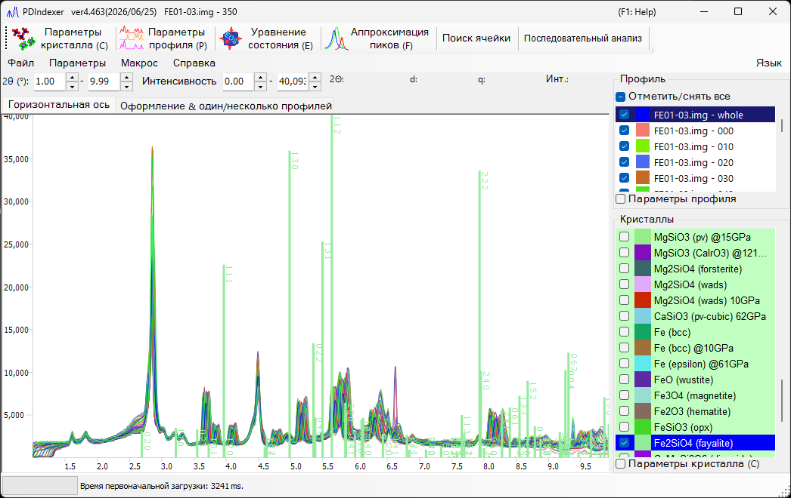
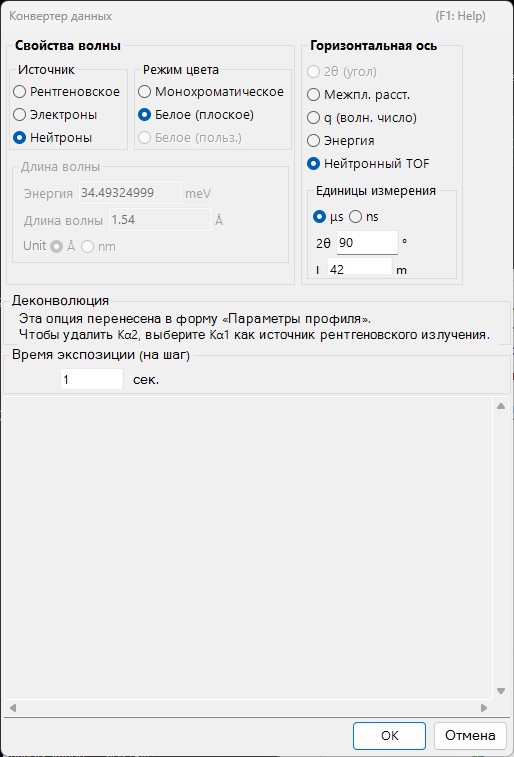

<!-- 260601Cl: migrated from legacy docx + yseto.net web manual -->
# Профили дифрактограмм

На этой странице описываются сами «данные профиля» (измеренный набор данных), с которыми работает PDIndexer, а также их загрузка, отображение и экспорт. Обработка, применяемая после загрузки — сглаживание, вычитание фона и так далее — выполняется в окне [Параметры профиля](4-profile-parameter.md). Полный список поддерживаемых расширений файлов см. в разделе [Форматы файлов](appendix/file-formats.md).

## Что такое профиль

Профиль — это одномерный набор данных «горизонтальная ось vs интенсивность», получаемый в результате измерения порошковой дифракции. Горизонтальная ось выражается одним из следующих способов, в зависимости от геометрии измерения:

- \( 2\theta \) (угол дифракции) для угловой дисперсионной дифракции (обычная рентгеновская дифракция)
- Энергия для энергодисперсионных измерений (белое рентгеновское излучение, детектирование SSD)
- Время пролёта для метода времени пролёта нейтронов (TOF)
- В любом случае данные можно также обрабатывать внутренне после преобразования в межплоскостное расстояние \( d \) или вектор рассеяния \( q \)

Вертикальная ось — это интенсивность дифракции, которая может отображаться как `Исходные отсчёты` или как отсчёты, делённые на время экспозиции в секундах (`Отсчёты на шаг (CPS)`), в линейном или логарифмическом масштабе (см. `Вертикальная ось` на странице [Главное окно](1-main-window.md)).

## Поддерживаемые форматы ввода

`Файл` ▸ `Прочитать профиль(и)` загружает как собственный формат PDIndexer, так и вывод других программ и обобщённые текстовые форматы.

| Расширение | Содержимое |
| --- | --- |
| `pdi` / `pdi2` | Собственный формат профиля PDIndexer (включает настройки осей и информацию об обработке) |
| `csv` | Вывод WinPIP (с разделителями-запятыми) |
| `chi` | Вывод Fit2D |
| `tsv` | Текст с разделителями-табуляцией |
| `ras` | Формат Rigaku (RAS) |
| `nxs` | Формат NeXus |
| `npd` / `xbm` / `rpt` (`rpf`) | Необработанные данные SSD (полупроводниковый детектор) |
| Прочий текст | Как правило, читается любой двухколоночный текст угол (или значение d) — интенсивность |

!!! note "Чтение обобщённого текста"
    Файлы, сохранённые в виде текста угол–интенсивность, обычно можно прочитать, даже если они не соответствуют ни одному из перечисленных выше стандартных форматов. Если тип горизонтальной оси или длину волны/энергию определить не удаётся, укажите их в диалоге `Конвертер данных`, описанном ниже.

Подробные спецификации каждого формата собраны в разделе [Форматы файлов](appendix/file-formats.md).

## Способы загрузки

Профили можно загружать несколькими способами.

- **Меню** — `Файл` ▸ `Прочитать профиль(и)`. Можно выбрать сразу несколько файлов.
- **Перетаскивание** — перетащите файлы из проводника в главное окно.
- **Слежение за буфером обмена** — если включено `Параметры` ▸ `Следить за буфером обмена`, профили/кристаллы, скопированные из других приложений (например, IPAnalyzer или CSManager), импортируются автоматически.
- **Слежение за файлом** — если включено `Параметры` ▸ `Следить за файлом` и папка выбрана командой `Задать отслеживаемый каталог`, новые файлы профилей `pdi`, созданные в этой папке, читаются автоматически. Это удобно для отображения в реальном времени при непрерывном измерении.

!!! tip "Автоматическое выравнивание горизонтальной оси"
    Установка флажка `После загрузки профиля изменять горизонтальную ось` переключает отображение горизонтальной оси в соответствие с только что загруженным профилем сразу после его чтения.

## Режимы Single Profile и Multi Profiles

Переключайте режим отображения переключателем `Один/несколько профилей` в правой части главного окна.

- `Один профиль` — при загрузке нового профиля предыдущие данные заменяются; одновременно отображается только один профиль.
- `Несколько профилей` — загруженные профили накладываются друг на друга. Используйте `Прирост интенсивности на профиль`, чтобы немного сместить интенсивность каждого профиля — так несколько кривых легче различать. Включение `Change automatically color` автоматически назначает каждому профилю свой цвет отрисовки.

## Список профилей

Список `Профиль` в правой части главного окна показывает все загруженные профили.

- В центральной области просмотра отрисовываются только отмеченные профили. Используйте `Отметить/снять все`, чтобы переключить их все разом.
- Щёлкните по столбцу `Цвет`, чтобы изменить цвет отрисовки каждого профиля.
- Измените порядок записей в списке, чтобы настроить порядок наложения при отрисовке.
- В режиме `Один профиль` список отключён, а в режиме `Несколько профилей` отображается несколько профилей.

Более детальные настройки профиля (имя, стиль линии, сглаживание, вычитание фона, коррекция оси, операции над профилем и так далее) выполняются в окне [Параметры профиля](4-profile-parameter.md), которое открывается установкой флажка `Параметры профиля` под списком.

## Диалог Data Converter

При загрузке обобщённого текстового файла, для которого не удаётся определить тип горизонтальной оси, или необработанных данных SSD (энергодисперсионных), открывается диалог `Конвертер данных`, позволяющий указать горизонтальную ось загружаемых данных и связанные с ней параметры.

В диалоге задаются следующие элементы.

| Элемент | Содержимое |
| --- | --- |
| Настройка горизонтальной оси | Укажите тип горизонтальной оси данных (длина волны/энергия рентгеновского излучения, 2θ, длина/угол TOF нейтронов и т. д.) и соответствующие исходные параметры. |
| `Время экспозиции (на шаг)` | Время экспозиции (измерения) на один шаг данных, в секундах. Используется для преобразования в CPS; значения ≤ 0 считаются равными 1. |
| `Деконволюция` | Удаление Kα2 перенесено в форму [Параметры профиля](4-profile-parameter.md). Чтобы удалить его, выберите Kα1 в качестве источника рентгеновского излучения. |
| `Отсечка низких энергий` в разделе `Для данных SSD` | Отбрасывает низкоэнергетическую сторону спектра EDX ниже порога (эВ) справа. |

Если тип горизонтальной оси — энергодисперсионный (белое рентгеновское излучение, EDX), введите коэффициенты энергетической калибровки `E = a₀ + a₁ n + a₂ n²` (E: энергия в eV, n: номер канала), чтобы преобразовать номера каналов в энергию. Нажмите `OK`, чтобы применить настройки и преобразовать данные, или `Отмена`, чтобы прервать импорт.

## Экспорт профилей

- `Файл` ▸ `Сохранить профиль(и)` — сохраняет все загруженные профили в собственном формате PDIndexer `pdi2`. Настройки осей и информация об обработке сохраняются.
- `Файл` ▸ `Экспортировать выбранный(е) профиль(и)` — экспортирует профили в одном из следующих форматов:
  - `как файл CSV (значения, разделённые запятыми)` — сохраняет отмеченные профили как значения, разделённые запятыми (X, Y), либо вместе в одном файле, либо по одному файлу на профиль. После выбора места сохранения ответьте `Да`, чтобы объединить их, или `Нет`, чтобы сохранить по отдельности. X — координата отображаемой горизонтальной оси. Десятичным разделителем всегда служит `.`, независимо от региональных настроек.
  - `как файл TSV (значения, разделённые табуляцией)` — сохраняет то же содержимое с разделителями-табуляцией.
  - `как файл GSAS` — записывает выбранный профиль в формате данных GSAS (Ритвельд). Экспорт возможен, только если горизонтальная ось — 2θ или время пролёта нейтронов (TOF).

!!! note "Сохранение изображения"
    Чтобы сохранить не данные профиля, а само отрисованное изображение, используйте `Файл` ▸ `Копировать в буфер обмена` или `Файл` ▸ `Сохранить как Metafile` (EMF). EMF — это векторный формат, который можно импортировать в PowerPoint и Word.
