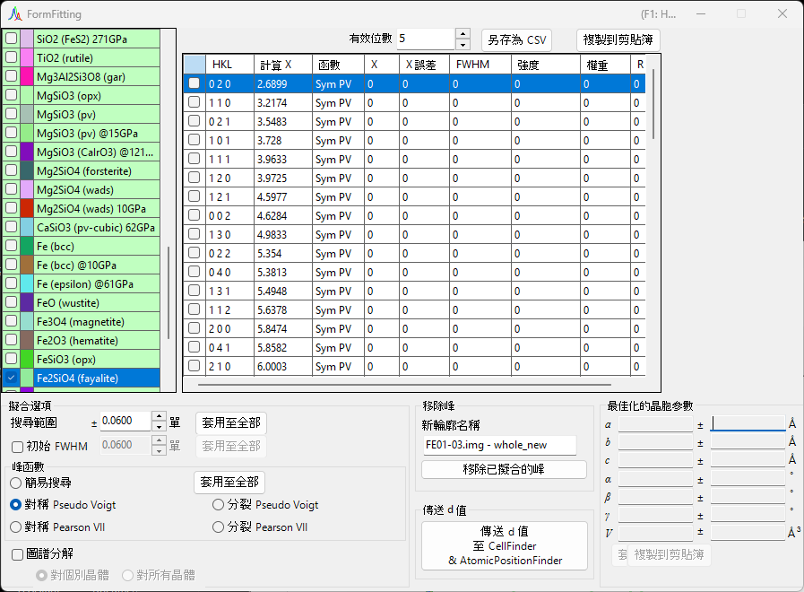
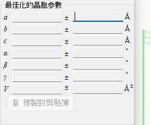
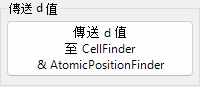
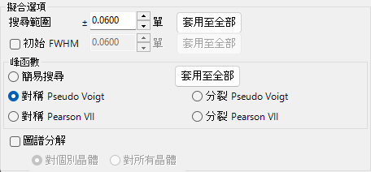
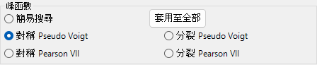
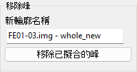
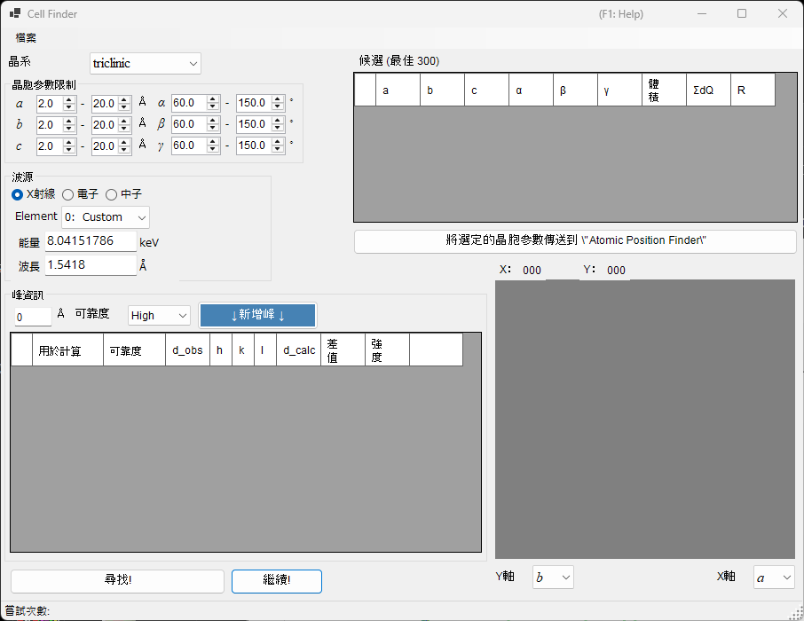

<!-- 260601Cl: migrated from legacy docx + yseto.net web manual -->
# 繞射峰擬合

`繞射峰擬合 (F)` 工具會以合適的函數擬合繞射圖譜的峰，從各峰位置 2θ 求出晶面間距(d值)，並以最小二乘法精修晶格常數。可從主視窗的工具列啟動。

## 基本操作流程

1. 在晶體清單中選取目標晶體（在多重圖譜模式下，也一併選取要處理的圖譜）。
2. 在主視窗中用滑鼠拖曳繞射線，使其盡量與量測到的峰重疊。
3. 從繞射峰清單（勾選清單方塊）中選擇要擬合的繞射線指數。
4. 一旦選取了足以求解最小二乘法計算的獨立指數，最可能的晶格常數就會連同誤差一起顯示在右下方的 `最佳化的晶胞參數` 面板中。
5. 按下 `套用至晶體` 即可將精修後的晶格常數回寫到主程式中的晶體。

!!! note "勾選並選取晶體"
    此處的晶體清單與主視窗中的相同。要讓擬合生效，目標晶體必須同時被勾選且被選取。

## 晶體清單

左上方的晶體清單包含與主視窗相同的晶體。在此勾選並選取的晶體即成為擬合的對象。詳情請參閱 [晶體參數](3-crystal-parameter.md)。

## 繞射峰清單

此處列出所選晶體的繞射線。勾選某一列的核取方塊，即可將該繞射線設為擬合對象。清單包含以下欄位。

| 欄位 | 內容 |
| --- | --- |
| `選取` | 是否將此線納入擬合 |
| `峰顏色` | 顯示顏色 |
| `晶體` | 晶體名稱 |
| `HKL` | 反射指數 |
| `計算 X` | 計算所得的繞射線位置 |
| `函數` | 所使用的峰函數 |
| `X` | 擬合求得的峰位置 |
| `X 誤差` | 峰位置的誤差 |
| `FWHM` | 半高全寬 |
| `強度` | 峰強度 |
| `權重` | 最小二乘法擬合中的權重 |
| `R` | 擬合的殘差指標 |

清單下方的按鈕可匯出結果。

- `複製到剪貼簿`: 將表格複製到剪貼簿。可直接貼到 Excel 等應用程式中。
- `另存為 CSV`: 將表格另存為 `.csv` 檔案。`有效位數` 用於設定表格中顯示的有效位數。
- `清除峰`: 刪除以手動方式新增到 Flexible Crystal 的所有峰。

## Fitting option（擬合選項）

在此進行擬合峰圖譜時所使用的詳細設定。

### Search Range / Initial FWHM

- `搜尋範圍`: 設定進行擬合的範圍。也就是說，計算所得繞射線位置 ±`搜尋範圍` 的區域，會被視為該峰的擬合對象範圍。
- `初始 FWHM`: 指定圖譜函數的初始半高全寬。作為最小二乘法收斂的起始值使用。

按下 `套用至全部` 會將目前的設定一次套用到所有繞射線。

### Peak function（峰函數）

選擇擬合所使用的峰函數。

| 峰函數 | 內容 |
| --- | --- |
| `簡易搜尋` | 不進行函數擬合，將計算所得繞射線位置 ±`搜尋範圍` 範圍內強度最強的點視為峰位置。 |
| `對稱 Pseudo Voigt` | 以左右對稱的擬 Voigt 函數擬合。 |
| `對稱 Pearson VII` | 以左右對稱的 Pearson VII 函數擬合。 |
| `分裂 Pseudo Voigt` | 以左右不對稱（分裂型）的擬 Voigt 函數擬合。 |
| `分裂 Pearson VII` | 以左右不對稱（分裂型）的 Pearson VII 函數擬合。 |

!!! tip "建議使用的函數"
    若無特殊理由，建議使用穩定性較佳的 `對稱 Pseudo Voigt`。

擬 Voigt 函數是高斯函數 \(G(x)\) 與勞侖茲函數 \(L(x)\) 以混合參數 \(\eta\) 線性組合而成，公式如下：

$$
\mathrm{pV}(x) = \eta\, L(x) + (1-\eta)\, G(x), \qquad 0 \le \eta \le 1
$$

其中 \(\eta\) 為勞侖茲成分所佔的比例。分裂型則是在峰位置左右分別獨立取用半高全寬等參數，藉此表現不對稱的圖譜形狀。

### Pattern Decomposition（圖譜分解）

當所選取的兩條以上繞射線之 `搜尋範圍` 發生重疊時，此選項用於選擇是否進行圖譜分解（同時擬合重疊的峰）。

- `對個別晶體`: 針對每個晶體各自獨立進行圖譜分解。
- `對所有晶體`: 跨越所有晶體進行圖譜分解。

## Optimized cell constants（最佳化的晶胞參數）

一旦選取了足以使最小二乘法計算可解的獨立指數，此面板會顯示最可能的晶格常數 \(a, b, c, \alpha, \beta, \gamma\) 與體積 \(V\)，並各自附上誤差（`±`）。

!!! note "關於 NA 顯示"
    當擬合的反射數等於獨立晶格常數的個數時，無法由殘差求得標準誤差，因此誤差欄會顯示 `NA`。當獨立反射太少、無法求解晶格常數時，程式會保持原本的晶胞形狀、只改變其整體比例，誤差也會顯示為 `NA`。選取足夠數量的獨立反射即可計算出誤差。

- `套用至晶體`: 將精修後的晶格常數回寫到主程式中所選取的晶體。
- `複製到剪貼簿`: 將最佳化的晶格常數複製到剪貼簿。

## Remove fitted peaks（移除已擬合的峰）

此功能會從圖譜中減去已擬合的峰，並將殘差圖譜輸出為新的圖譜。在 `新輪廓名稱` 中輸入目的地名稱，再按下 `移除已擬合的峰` 即可執行相減。適用於確認背景或重疊峰的分離情形。

## 相關工具（Send d-values）

按下 `傳送 d 值 至 CellFinder && AtomicPositionFinder` 會將已勾選反射經擬合所得的 d 值傳送到 `晶胞搜尋器`。`晶胞搜尋器` 可從工具列開啟。 <!-- 261124Cl changed (author decision): the Atomic Position Finder, not available in the current version, is no longer described -->

### Cell Finder

`晶胞搜尋器` 會從一組量測到的峰位置（d 值清單），搜尋可解釋這些位置的晶格常數候選。用於未知樣品的指標化。

!!! tip "鑑定未知樣品"
    以 `晶胞搜尋器` 求出晶格常數後，將該晶體登錄到晶體清單中，即可用本工具的最小二乘擬合進一步精修晶格常數。
